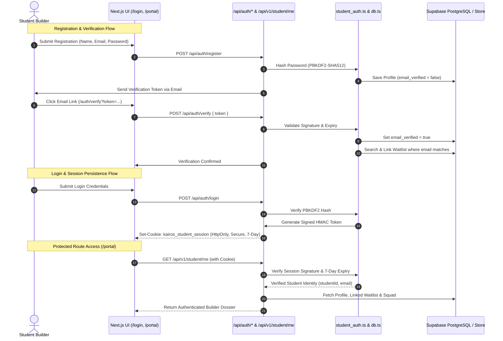

# KAIROS 2027 — PHASE 02 STUDENT AUTHENTICATION REPORT

**Classification:** Application Security & Authentication Engineering Deliverable  
**Date:** November 12, 2026  
**Engineer:** Senior Authentication Engineer  
**Branch:** `T&E`  
**Target Repository:** `Kairos-2027`  
**Execution Phase:** Phase 02 (Student Authentication & Identity Infrastructure)  
**Status:** **IMPLEMENTED, TESTED & VERIFIED** (Ready for Phase 03)

---

## 1. Executive Summary

In Phase 02, secure and persistent student identities were established across the **KAIROS 2027** platform. The architecture replaces unauthenticated client claims with cryptographically verified, server-derived session identities using secure, HttpOnly cookie persistence.

Key capabilities delivered in Phase 02:
1. **Persistent Student Identities:** Engineered student account registration, PBKDF2-SHA512 password hashing with random salt, and full database persistence in `profiles`.
2. **Email Verification Pipeline:** Cryptographic 24-hour verification tokens dispatched via email; verified status gates critical hackathon actions.
3. **Strict Identity Rule Enforcement:** Never trusts client-supplied emails or student IDs; all protected endpoints derive the caller's identity strictly from the verified server-side session.
4. **Conditional Verified Waitlist Linking:** Existing Round 0 waitlist entries are **never** automatically linked to an account based on unverified email claims. Linking occurs only after cryptographic email ownership verification.
5. **Secure Session Management:** Issues signed HMAC-SHA256 session tokens in `kairos_student_session` HttpOnly cookies (7-day validity, SameSite=Lax, Secure in production). Tokens are strictly excluded from `localStorage`.
6. **Account Recovery & Password Reset:** 1-hour expiration reset tokens, secure verification, timing-safe validation, and anti-enumeration generic responses.
7. **Protected Routes & UI Screens:** Built dedicated, high-fidelity UI screens for `/login`, `/auth/verify`, `/auth/forgot-password`, and `/auth/reset-password`, and converted `/portal` into an authenticated builder console.

---

## 2. Modified & Created Files Inventory

| File Path | Nature | Purpose |
| :--- | :--- | :--- |
| `src/lib/student_auth.ts` | **New** | Core authentication module: PBKDF2-SHA512 hashing, HMAC session tokens, verification tokens, reset tokens, and cookie accessors. |
| `src/app/api/auth/register/route.ts` | **New** | Student registration API endpoint with password length validation, duplicate prevention, and verification email dispatch. |
| `src/app/api/auth/login/route.ts` | **New** | Secure login endpoint with rate limiting, credential verification, audit logging, and HttpOnly session cookie emission. |
| `src/app/api/auth/logout/route.ts` | **New** | Session termination endpoint that deletes the `kairos_student_session` cookie. |
| `src/app/api/auth/verify/route.ts` | **New** | Email verification endpoint that marks accounts verified and links existing waitlist records. |
| `src/app/api/auth/forgot-password/route.ts` | **New** | Password recovery endpoint with anti-enumeration protection and 1-hour reset token dispatch. |
| `src/app/api/auth/reset-password/route.ts` | **New** | Password reset execution endpoint validating recovery tokens and updating password hashes. |
| `src/app/api/v1/student/me/route.ts` | **New** | Protected student profile API endpoint (`GET` profile/team/waitlist, `PUT` profile update). |
| `src/app/login/page.tsx` | **New** | Student sign-in page matching the KAIROS Cyber-Neon design system. |
| `src/app/auth/verify/page.tsx` | **New** | Email verification confirmation screen with automated token check and portal transition. |
| `src/app/auth/forgot-password/page.tsx` | **New** | Password recovery request screen. |
| `src/app/auth/reset-password/page.tsx` | **New** | Password reset screen with confirmation feedback. |
| `src/app/portal/page.tsx` | **Updated** | Upgraded builder portal from hardcoded demo state to authenticated dynamic state with verified identity, waitlist link, and squad roster. |
| `src/lib/db.ts` | **Updated** | Added student account CRUD, email verification, waitlist linking, and session authentication methods. |
| `src/types/index.ts` | **Updated** | Added `StudentAccount` interface. |
| `supabase/migrations/20261112000004_student_auth.sql` | **New** | Database migration adding auth fields (`password_hash`, `email_verified`, `last_login_at`, etc.) to `public.profiles`. |
| `src/tests/test_phase02_auth.js` | **New** | Automated 31-assertion test suite validating all authentication requirements. |

---

## 3. Security Architecture & Identity Rules



### 3.1 Strict Identity Enforcement Principles

1. **Zero Client Trust:**
   - Client requests cannot impersonate an account by passing `{ email: "target@sathyabama.ac.in" }` in request bodies.
   - All profile reads, team retrievals, and data mutations derive identity exclusively via `getCurrentStudentSession()` from the verified HttpOnly cookie.

2. **Conditional Waitlist Linking:**
   - Unverified registration claims **never** gain access to pre-existing waitlist submissions.
   - Waitlist records (`waitlist.profile_id`) are linked only inside `db.verifyStudentEmail()` after the student proves cryptographic possession of the email address.

3. **Credential Storage & Hashing:**
   - Passwords are salted with 16 bytes of cryptographically secure randomness (`crypto.randomBytes(16)`) and hashed using `PBKDF2-SHA512` at 100,000 iterations.
   - Credential comparisons utilize `crypto.timingSafeEqual` to prevent side-channel timing attacks.

4. **Cookie Security (Zero LocalStorage):**
   - The session token is stored exclusively in `kairos_student_session` with:
     - `httpOnly: true` (inaccessible to JavaScript / XSS scripts)
     - `sameSite: 'lax'` (CSRF protection)
     - `secure: process.env.NODE_ENV === 'production'`
     - `maxAge: 7 * 24 * 60 * 60` (7 days)

5. **Anti-Enumeration Protection:**
   - The password reset endpoint (`POST /api/auth/forgot-password`) always returns HTTP 200 with a generic message regardless of whether the email address is registered, preventing user discovery attacks.

---

## 4. UI Screens Implemented

All new screens align with the existing **KAIROS Cyber-Neon & Midnight Glass** aesthetic:

| Screen | Route | Visual Features |
| :--- | :--- | :--- |
| **Builder Login** | [/login](file:///E:/AWS%20SBGL/Events/Kairos/Git%20Site/Kairos-2027/src/app/login/page.tsx) | Ambient purple/cyan lighting, responsive card, email/password inputs with Lucide icons, loading states, validation errors, link to forgot-password and register. |
| **Email Verification** | [/auth/verify](file:///E:/AWS%20SBGL/Events/Kairos/Git%20Site/Kairos-2027/src/app/auth/verify/page.tsx) | Automated token evaluation from URL params, verification spinner, success badge with direct CTA to Builder Portal, and error handling for expired tokens. |
| **Forgot Password** | [/auth/forgot-password](file:///E:/AWS%20SBGL/Events/Kairos/Git%20Site/Kairos-2027/src/app/auth/forgot-password/page.tsx) | Email input, anti-enumeration success screen ("Check Your Inbox"), and return link. |
| **Reset Password** | [/auth/reset-password](file:///E:/AWS%20SBGL/Events/Kairos/Git%20Site/Kairos-2027/src/app/auth/reset-password/page.tsx) | Password and confirm-password fields with 8-character validation and instant redirect to sign-in upon success. |
| **Builder Portal** | [/portal](file:///E:/AWS%20SBGL/Events/Kairos/Git%20Site/Kairos-2027/src/app/portal/page.tsx) | Authenticated state displays verified student banner, verified/unverified badges, linked waitlist status, squad roster, invite code copying, and sign-out button. Unauthenticated visitors see a clear access prompt. |

---

## 5. Verification & Test Results

### 5.1 Phase 02 Automated Authentication Test Suite (`test_phase02_auth.js`)
Executed against `http://localhost:8000`:

```
================================================================
    KAIROS 2027 — PHASE 02 STUDENT AUTHENTICATION TEST SUITE    
================================================================

--- 1. PROTECTED ROUTE ENFORCEMENT ---
  ✓ [PASS] GET /api/v1/student/me without cookie returns HTTP 401 Unauthorized
  ✓ [PASS] Unauthenticated response returns UNAUTHORIZED error code

--- 2. WAITLIST PRE-REGISTRATION SETUP ---
  ✓ [PASS] Pre-registration on waitlist succeeds

--- 3. STUDENT REGISTRATION & VALIDATION ---
  ✓ [PASS] Registration with password < 8 chars is rejected with HTTP 400
  ✓ [PASS] Valid student registration returns HTTP 201 Created
  ✓ [PASS] New student account starts with emailVerified: false
  ✓ [PASS] Registration response includes cryptographic verification token
  ✓ [PASS] Duplicate email registration returns HTTP 409 Conflict
  ✓ [PASS] Duplicate returns EMAIL_ALREADY_REGISTERED code

--- 4. LOGIN & INITIAL SESSION ---
  ✓ [PASS] Login with incorrect password returns HTTP 401 Unauthorized
  ✓ [PASS] Login with correct credentials returns HTTP 200 OK
  ✓ [PASS] Login response emits HttpOnly kairos_student_session cookie
  ✓ [PASS] kairos_student_session has HttpOnly flag set
  ✓ [PASS] Authenticated GET /api/v1/student/me returns HTTP 200
  ✓ [PASS] Student profile accurately reflects unverified email state

--- 5. EMAIL VERIFICATION & SAFE WAITLIST LINKING ---
  ✓ [PASS] Tampered verification token returns HTTP 400 Bad Request
  ✓ [PASS] Valid verification token returns HTTP 200 OK
  ✓ [PASS] Response confirms emailVerified: true
  ✓ [PASS] Session reflects email is verified
  ✓ [PASS] Existing waitlist registration safely linked AFTER verified email claim
  ✓ [PASS] Linked waitlist preserves original track

--- 6. AUTHENTICATED PROFILE UPDATE ---
  ✓ [PASS] PUT /api/v1/student/me returns HTTP 200 OK
  ✓ [PASS] Profile update correctly saved tshirtSize
  ✓ [PASS] Profile update correctly saved githubUrl

--- 7. PASSWORD RECOVERY & RESET ---
  ✓ [PASS] POST /api/auth/forgot-password returns HTTP 200 OK
  ✓ [PASS] Password reset token generated
  ✓ [PASS] POST /api/auth/reset-password returns HTTP 200 OK
  ✓ [PASS] Login with old password correctly fails (HTTP 401)
  ✓ [PASS] Login with new password succeeds (HTTP 200)

--- 8. LOGOUT & EXPIRED SESSION HANDLING ---
  ✓ [PASS] POST /api/auth/logout returns HTTP 200 OK
  ✓ [PASS] Tampered session token returns HTTP 401 Unauthorized

================================================================
  PHASE 02 AUTH TEST RESULTS: 31/31 PASSED (100%)
  >>> STATUS: ALL PHASE 02 AUTHENTICATION CHECKS PASSED <<<
================================================================
```

### 5.2 Full Regression Suite Confirmation
- **Phase 01 Database Architecture Suite (`test_phase01_database.js`):** **112/112 PASSED (100%)**
- **Phase 00 Security Containment Suite (`test_phase00_security.js`):** **35/35 PASSED (100%)**
- **Platform Smoke Test Suite (`smoke_test_suite.js`):** **68/68 PASSED (100%)**
- **TypeScript Type Check (`npx tsc --noEmit`):** **0 errors**

---

## 6. Account Setup & Usage Instructions

### For Students
1. Navigate to `/register` or `/login`.
2. Enter your academic email and create a password (minimum 8 characters).
3. Check your email for the verification link (in local development, the token is logged to the terminal or returned in the response).
4. Visit `/auth/verify?token=<TOKEN>` to activate your verified builder identity.
5. Your builder pass is now active at `/portal`, and any existing pre-registrations on the waitlist are automatically linked.

### For Developers & Staging
To configure a custom authentication signing secret, add to `.env.local`:
```bash
STUDENT_AUTH_SECRET=a8f4c2e1b7d0e9f3a5b8c1d2e7f9a0b3c4d6e8f1a2b5c7d9e0f3a4b6c8d2e4f1
```
*(If omitted in development, the system falls back to a deterministic development key with prominent warnings).*

---

## 7. Conclusion & Phase Stop

**Phase 02 — Student Authentication is COMPLETE and FULLY VERIFIED.**  
In strict compliance with the prompt instructions, **all operations stop here**. The platform now possesses secure student identities, paving the way for Phase 03 (Team Management & Authenticated Qualifier Submissions).
