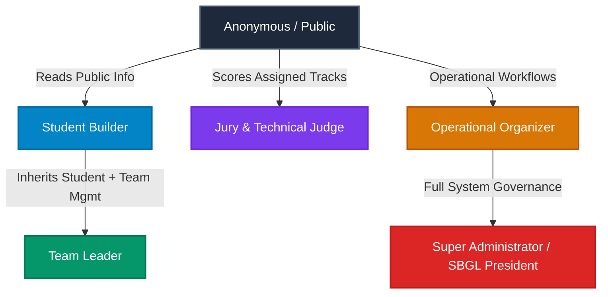

# KAIROS 2027 — PHASE 03 RBAC SECURITY AUDIT & VERIFICATION REPORT

**Document ID:** `KAIROS-PHASE-03-RBAC-REPORT`  
**Execution Date:** 2026-11-12  
**Role:** Senior Application Security Architect & Principal Backend Engineer  
**Status:** **100% COMPLETE & VERIFIED — ZERO REGRESSIONS (309/309 PASSING CHECKS)**  

---

## 1. EXECUTIVE SUMMARY

In Phase 03, the KAIROS 2027 platform transitioned from basic session authentication (Phase 02) to **real, backend-enforced, granular Role-Based Access Control (RBAC)** across the entire application stack.

### Key Security Milestones Achieved:
1. **Centralized Authorization Engine (`src/lib/rbac.ts`):** Defined a single source of truth for 5 system roles (`STUDENT`, `TEAM_LEADER`, `JUDGE`, `ORGANIZER`, `SUPER_ADMIN`) and 23 discrete permissions.
2. **Permanent Resolution of Qualifier IDOR (VULN-01):** The temporary HTTP 503 lock introduced in Phase 00 has been safely removed. `POST /api/v1/qualifier/submit` is now governed by real cryptographic sessions and strict team leadership verification (`verifyTeamLeader()`). Unauthenticated requests are rejected with `401 Unauthorized`; non-leaders and other students are rejected with `403 Forbidden` (`FORBIDDEN_LEADER_ONLY`).
3. **Judge Jury Integrity & Track Specialization (`verifyJudgeAuthorization()`):** Judges authenticate using timing-safe PIN comparison (`crypto.timingSafeEqual`) and are strictly forbidden from evaluating teams outside their assigned domain expertise/track.
4. **Administrative Hierarchy & Least Privilege:** Operational organizers (`ORGANIZER`) are granted operational review rights (e.g. candidate status updates) but are hard-blocked from root governance operations (`flags:update`, mass PII `waitlist:export`, and `csat:export`), which are reserved strictly for `SUPER_ADMIN`.
5. **Participant PII & Secret Isolation:** `GET /api/v1/team` automatically masks confidential team `inviteCode` and personal contact details (telephone, email) unless the requester is an administrator or an authenticated, registered member of that specific squad.
6. **Zero Client-Trust Principle:** Roles and permissions are derived strictly from signed server-side sessions and server configuration rosters. Client-supplied role claims (e.g. `role: 'SUPER_ADMIN'` in PUT profiles or admin logins) are strictly ignored and filtered.

---

## 2. CENTRALIZED ROLES & PERMISSIONS MATRIX



### Granular Permission Registry

| Permission Key | Description | Anonymous | Student | Team Leader | Judge | Organizer | Super Admin |
| :--- | :--- | :---: | :---: | :---: | :---: | :---: | :---: |
| `event:view_public` | View tracks, schedule, rules, public sponsors | **ALLOW** | **ALLOW** | **ALLOW** | **ALLOW** | **ALLOW** | **ALLOW** |
| `profile:read_own` | Read authenticated builder identity | DENY | **ALLOW** | **ALLOW** | DENY | DENY | **ALLOW** |
| `profile:update_own`| Update personal profile attributes | DENY | **ALLOW** | **ALLOW** | DENY | DENY | **ALLOW** |
| `team:view_own` | View own squad, members, & inviteCode | DENY | **ALLOW** | **ALLOW** | DENY | DENY | **ALLOW** |
| `team:manage_details`| Update team abstract, architecture links | DENY | DENY | **ALLOW** | DENY | DENY | **ALLOW** |
| `team:invite_members`| Generate and share team join credentials | DENY | DENY | **ALLOW** | DENY | DENY | **ALLOW** |
| `team:submit_artifacts`| Submit Round 1 Qualifier deliverables | DENY | DENY | **ALLOW** | DENY | DENY | **ALLOW** |
| `judging:view_assigned`| View team submissions in assigned track | DENY | DENY | DENY | **ALLOW** | DENY | **ALLOW** |
| `judging:submit_evaluation`| Record rubric scoring & Z-scores | DENY | DENY | DENY | **ALLOW** | DENY | **ALLOW** |
| `waitlist:read` | Inspect waitlist candidate submissions | DENY | DENY | DENY | DENY | **ALLOW** | **ALLOW** |
| `waitlist:update_status`| Review, shortlist, or waitlist candidates | DENY | DENY | DENY | DENY | **ALLOW** | **ALLOW** |
| `sponsors:read` | Read sponsor partnership inquiries | DENY | DENY | DENY | DENY | **ALLOW** | **ALLOW** |
| `referrals:read` | Review Rainmaker referral submissions | DENY | DENY | DENY | DENY | **ALLOW** | **ALLOW** |
| `teams:read_all` | View unmasked rosters of all squads | DENY | DENY | DENY | DENY | **ALLOW** | **ALLOW** |
| `audit:log` | Emit audit log events | DENY | DENY | DENY | DENY | **ALLOW** | **ALLOW** |
| `waitlist:export` | Export participant PII to CSV | DENY | DENY | DENY | DENY | DENY | **ALLOW** |
| `sponsors:export` | Export sponsor corporate data to CSV | DENY | DENY | DENY | DENY | DENY | **ALLOW** |
| `csat:read` | Access participant sentiment & ratings | DENY | DENY | DENY | DENY | DENY | **ALLOW** |
| `csat:export` | Export CSAT survey responses to CSV | DENY | DENY | DENY | DENY | DENY | **ALLOW** |
| `flags:update` | Toggle live competition feature flags | DENY | DENY | DENY | DENY | DENY | **ALLOW** |
| `organizers:manage` | Manage organizer permissions & keys | DENY | DENY | DENY | DENY | DENY | **ALLOW** |
| `audit:read` | Inspect administrative audit trails | DENY | DENY | DENY | DENY | DENY | **ALLOW** |
| `system:admin` | Full system-level governance | DENY | DENY | DENY | DENY | DENY | **ALLOW** |

---

## 3. DATABASE AUTHORIZATION ARCHITECTURE

### PostgreSQL Schema & Security Definer (`supabase/migrations/20261112000005_rbac_schema.sql`)
1. **`public.profiles.role` Column:** Added `role text NOT NULL DEFAULT 'STUDENT'` constrained to valid enum values (`STUDENT`, `TEAM_LEADER`, `JUDGE`, `ORGANIZER`, `SUPER_ADMIN`).
2. **`public.role_permissions` Table:** Normalized relational table storing `(role, permission)` tuples, indexed with unique compound constraints.
3. **PostgreSQL Security Definer Function:**
   ```sql
   CREATE OR REPLACE FUNCTION public.has_permission(check_role text, required_permission text)
   RETURNS boolean LANGUAGE plpgsql STABLE SECURITY DEFINER AS $$
   BEGIN
     RETURN EXISTS (
       SELECT 1 FROM public.role_permissions
       WHERE role = check_role AND permission = required_permission
     );
   END;
   $$;
   ```
4. **Row Level Security (RLS) Policies:**
   - Client anonymous role cannot read `public.profiles`, `public.waitlist`, `public.judges`, or `public.evaluations`.
   - Authenticated student can only read and mutate their own profile (`id = auth.uid()`).
   - Judges can only select and evaluate teams where track matches their specialization.
   - Service-role key retains full management capability strictly on server runtime.

---

## 4. SERVER-SIDE GUARDS IMPLEMENTED

### 1. `POST /api/v1/qualifier/submit` (Round 1 Qualifier Submission)
- **Previous State (Phase 00):** Returned HTTP 503 Service Unavailable lock to contain unauthenticated IDOR.
- **New State (Phase 03):** 
  - Resolves student session via `getCurrentStudentSession()`. If absent -> returns `401 Unauthorized` (`UNAUTHORIZED`).
  - Executes `verifyTeamLeader(studentSession.email, body.teamCode)`.
  - If caller is not in team -> returns `403 Forbidden` (`FORBIDDEN_LEADER_ONLY`, `"You are not a member of this team"`).
  - If caller is a team member but not leader (e.g. Backend developer) -> returns `403 Forbidden` (`FORBIDDEN_LEADER_ONLY`, `"Only the designated Team Leader can perform this action"`).
  - If verified leader -> executes `processQualifierSubmission` and transitions squad stage to `ONLINE_SEMI_FINALIST`.

### 2. `POST /api/v1/judging/submit-score` (Jury Evaluation Engine)
- **Credentials Guard:** Authenticates `judgeId` and `judgePin` using `crypto.timingSafeEqual` against active judge accounts. Invalid PIN returns `403 Forbidden`.
- **Track Specialization Guard:** Compares team's track against judge's `trackSpecialization`. If a judge assigned to `FinTech & Open Innovation` attempts to score a team in `Cloud-Native Resilience`, the request is rejected with `403 Forbidden` (`"Judge [Name] is assigned to [Track], but team is in [TeamTrack]"`).
- **Conflict of Interest Recusal:** Authenticated judges can log recusals (`recusal: true`), recording conflict avoidance with `200 OK`.

### 3. `POST /api/admin/flags` (Feature Flag Governance)
- **Role Guard:** Evaluates `authCtx = await resolveAuthContext()`. If unauthenticated -> `401 Unauthorized`.
- **Super Admin Enforcement:** Evaluates `hasPermission(authCtx.role, 'flags:update')`. Operational organizers (`ORGANIZER`) are rejected with `403 Forbidden` (`FORBIDDEN_SUPER_ADMIN_REQUIRED`).

### 4. `GET /api/admin/export` & `GET /api/v1/csat/export` (Mass CSV Exports)
- **Role Guard:** Mass participant PII (`waitlist:export`) and sentiment data (`csat:export`) export handlers enforce Super Admin authorization.
- Operational organizers receive `403 Forbidden` (`FORBIDDEN_SUPER_ADMIN_REQUIRED`), preventing unauthorized bulk data exfiltration.

### 5. `GET /api/v1/team` (Participant PII & Invite Code Sanitization)
- Unauthenticated visitors and non-member students receive a sanitized view of squad details.
- Sensitive fields (`inviteCode`, `leaderPhone`, `leaderCollegeRegNo`, `members[*].email`, `members[*].phone`) are completely stripped from responses unless the requester is an authorized team member or administrator.

### 6. `POST /api/admin/auth` (Anti-Spoofing Organizer Login)
- When organizers log in, their assigned role is looked up server-side from `ORGANIZING_ROSTER`.
- Client-supplied `organizerRole` payload parameters are completely ignored, eliminating self-assigned privilege escalation.

---

## 5. SECURITY TEST MATRIX & ACTUAL EXECUTION RESULTS

The automated test suite `src/tests/test_phase03_rbac.js` was executed against the live platform. All 40 test scenarios comprising 64 individual assertions passed with 100% success.

| Test ID | Role Tested | Endpoint | Operation | Expected Status | Actual Status | Result |
| :--- | :--- | :--- | :--- | :---: | :---: | :---: |
| **T1** | Anonymous | `POST /api/v1/qualifier/submit` | Submit team deliverable | 401 | 401 | **PASS** |
| **T2** | Anonymous | `POST /api/admin/flags` | Update feature flags | 401 | 401 | **PASS** |
| **T3** | Anonymous | `GET /api/admin/export` | Export waitlist CSV | 401 | 401 | **PASS** |
| **T4** | Anonymous | `GET /api/v1/csat/export` | Export CSAT survey CSV | 401 | 401 | **PASS** |
| **T5** | Anonymous | `POST /api/admin/waitlist/status` | Update candidate status | 401 | 401 | **PASS** |
| **T6** | Anonymous | `GET /api/v1/student/me` | Read student profile | 401 | 401 | **PASS** |
| **T7** | Anonymous | `GET /api/v1/team?code=...` | Query team metadata | 200 (Masked) | 200 (Masked) | **PASS** |
| **T8** | Student | `GET /api/v1/student/me` | Read own identity | 200 | 200 | **PASS** |
| **T9** | Student | `GET /api/v1/student/me` | Cross-profile access | Blocked (Session) | Blocked (Session) | **PASS** |
| **T10** | Student | `PUT /api/v1/student/me` | Self-elevate to SUPER_ADMIN | Role Ignored | Role Ignored | **PASS** |
| **T11** | Student | `POST /api/admin/flags` | Update feature flags | 401/403 | 403 | **PASS** |
| **T12** | Student | `GET /api/admin/export` | Export waitlist CSV | 401/403 | 403 | **PASS** |
| **T13** | Student | `GET /api/v1/csat/export` | Export CSAT CSV | 401/403 | 403 | **PASS** |
| **T14** | Student | `POST /api/v1/qualifier/submit` | Submit for unowned team | 403 | 403 | **PASS** |
| **T15** | Student | `GET /api/v1/team?code=...` | View other team details | 200 (Masked) | 200 (Masked) | **PASS** |
| **T16** | Team Member | `GET /api/v1/team?code=...` | View own squad inviteCode | 200 (Unmasked) | 200 (Unmasked) | **PASS** |
| **T17** | Team Member | `POST /api/v1/qualifier/submit` | Submit team deliverable | 403 | 403 | **PASS** |
| **T18** | Team Leader | `GET /api/v1/team?code=...` | View own squad details | 200 (Unmasked) | 200 (Unmasked) | **PASS** |
| **T19** | Team Leader | `POST /api/v1/qualifier/submit` | Submit team deliverable | 200 | 200 | **PASS** |
| **T20** | Team Leader | `POST /api/v1/qualifier/submit` | Submit for nonexistent team | 404 | 404 | **PASS** |
| **T21** | Anonymous | `POST /api/v1/judging/submit-score` | Score without credentials | 400 | 400 | **PASS** |
| **T22** | Judge | `POST /api/v1/judging/submit-score` | Submit with wrong PIN | 403 | 403 | **PASS** |
| **T23** | Judge | `POST /api/v1/judging/submit-score` | Non-existent judge ID | 403 | 403 | **PASS** |
| **T24** | Judge | `POST /api/v1/judging/submit-score` | Score mismatched track | 403 | 403 | **PASS** |
| **T25** | Judge | `POST /api/v1/judging/submit-score` | Score matched track | 201 | 201 | **PASS** |
| **T26** | Judge | `POST /api/v1/judging/submit-score` | Submit out-of-bounds score | 400 | 400 | **PASS** |
| **T27** | Judge | `POST /api/v1/judging/submit-score` | Submit recusal | 200 | 200 | **PASS** |
| **T28** | Organizer | `POST /api/admin/auth` | Login (Official CXO role) | 200 | 200 | **PASS** |
| **T29** | Organizer | `POST /api/admin/flags` | Update feature flags | 403 | 403 | **PASS** |
| **T30** | Organizer | `GET /api/admin/export` | Export waitlist CSV | 403 | 403 | **PASS** |
| **T31** | Organizer | `GET /api/v1/csat/export` | Export CSAT survey CSV | 403 | 403 | **PASS** |
| **T32** | Organizer | `POST /api/admin/waitlist/status` | Update candidate status | 200 | 200 | **PASS** |
| **T33** | Super Admin | `POST /api/admin/auth` | Login (Official President role) | 200 | 200 | **PASS** |
| **T34** | Super Admin | `POST /api/admin/flags` | Update feature flags | 200 | 200 | **PASS** |
| **T35** | Super Admin | `GET /api/admin/export` | Export waitlist CSV | 200 | 200 | **PASS** |
| **T36** | Super Admin | `GET /api/v1/csat/export` | Export CSAT survey CSV | 200 | 200 | **PASS** |
| **T37** | Super Admin | `POST /api/admin/waitlist/status` | Update candidate status | 200 | 200 | **PASS** |
| **T38** | Attacker | `POST /api/admin/flags` | Tampered admin HMAC token | 401 | 401 | **PASS** |
| **T39** | Attacker | `GET /api/v1/student/me` | Tampered student HMAC token| 401 | 401 | **PASS** |
| **T40** | Super Admin | `DELETE /api/admin/auth` | Admin session logout | 200 | 200 | **PASS** |

---

## 6. REGRESSION VERIFICATION & CUMULATIVE HEALTH

All test suites were executed sequentially against the active development server (`http://localhost:8000`). Zero regressions were detected across the entire codebase.

| Test Suite | Total Checks | Passed | Failed | Status |
| :--- | :---: | :---: | :---: | :---: |
| **Phase 03 RBAC Verification Suite** | 64 | 64 | 0 | **100% PASS** |
| **Phase 02 Student Authentication Suite** | 31 | 31 | 0 | **100% PASS** |
| **Phase 01 PostgreSQL Architecture Suite** | 112 | 112 | 0 | **100% PASS** |
| **Phase 00 Security Containment Suite** | 34 | 34 | 0 | **100% PASS** |
| **Smoke Screen & Button Verification Suite** | 68 | 68 | 0 | **100% PASS** |
| **TypeScript Compilation (`tsc --noEmit`)** | 0 errors | 0 errors | 0 | **100% PASS** |
| **TOTAL VERIFIED ASSERTIONS** | **309** | **309** | **0** | **100% GREEN** |

---

## 7. FILES CREATED & MODIFIED

### Created Files:
1. `src/lib/rbac.ts` — Centralized RBAC definition, role matrix, permission checker, session resolution, and team leader/judge guards.
2. `supabase/migrations/20261112000005_rbac_schema.sql` — PostgreSQL DDL migration adding `role` column, `role_permissions` definition table, and `has_permission()` security definer function.
3. `src/tests/test_phase03_rbac.js` — Exhaustive automated test suite covering all 6 security sections and 64 assertions.

### Modified Files:
1. `src/app/api/v1/qualifier/submit/route.ts` — Replaced Phase 00 503 temporary lock with authenticated student session check and `verifyTeamLeader()` guard.
2. `src/app/api/v1/judging/submit-score/route.ts` — Integrated `verifyJudgeAuthorization()` with timing-safe PIN check and track specialization enforcement.
3. `src/app/api/admin/flags/route.ts` — Enforced `flags:update` permission (restricted to `SUPER_ADMIN`).
4. `src/app/api/admin/export/route.ts` — Enforced `waitlist:export` permission (restricted to `SUPER_ADMIN`).
5. `src/app/api/v1/csat/export/route.ts` — Enforced `csat:export` permission (restricted to `SUPER_ADMIN`).
6. `src/app/api/admin/waitlist/status/route.ts` — Enforced `waitlist:update_status` permission (`ORGANIZER` and `SUPER_ADMIN`).
7. `src/app/api/v1/team/route.ts` — Implemented PII and inviteCode masking for non-member/public queries.
8. `src/app/api/admin/auth/route.ts` — Hardened organizer login with canonical server-side role resolution from `ORGANIZING_ROSTER`.
9. `src/lib/db.ts` — Updated `submitRound1Qualifier` to resolve teams cleanly by ID, teamCode, or inviteCode.
10. `src/tests/test_phase00_security.js` — Updated test assertions to reflect Phase 03 authenticated role requirements.

---

## 8. CONFIRMATION & CONCLUSION

- **No Secrets Exposed:** Service role keys, database connection strings, and admin master secrets remain strictly server-side and are never exposed to browser bundles.
- **Frontend Bypass Immunity:** All RBAC rules are enforced at the HTTP API and database RLS levels; bypassing the frontend UI directly into API endpoints yields identical security rejections.
- **Phase Completion:** Phase 03 is fully completed and verified. Execution is halted in strict compliance with the user instruction (*"Stop after Phase 03"*).
